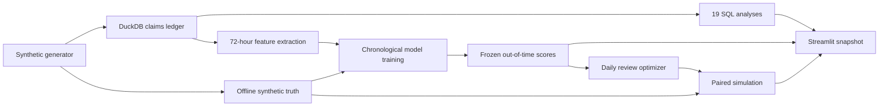
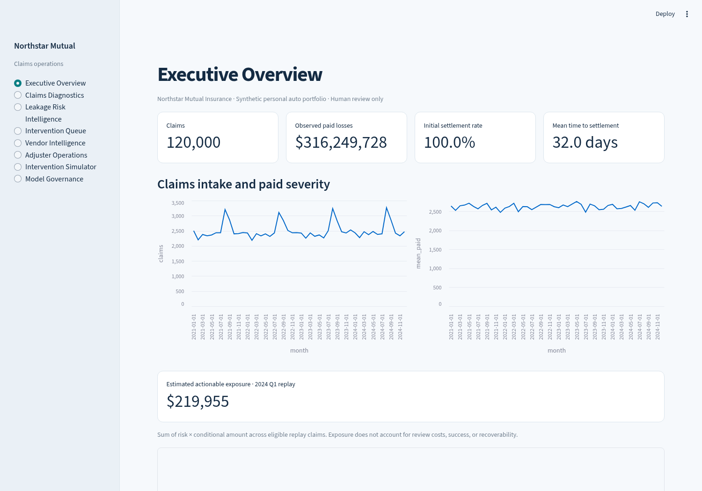

# [ClaimNexa](https://claiminsurance.streamlit.app/): Insurance Claims Leakage & Early Intervention Intelligence

Northstar Mutual Insurance is a fictional US personal auto insurer. This project helps claims teams explore avoidable expenses and prioritize discretionary human review within budget, staffing and customer-delay constraints. A large payment can be appropriate for a complex claim. Review recommendations carry no authority over claim payments, coverage, or fraud determinations.

## Architecture



The generator produces 120,000 claims reported from 2021 through 2024 across eight states, three coverage categories, 60 vendors and eight adjuster teams. It records policies, claims, events, payments, reserves and routine interventions. The dataset is synthetic and includes no customer data. Early features exclude geographic, adjuster and team identifiers, future transactions and evaluation labels.

## Results

See the [measured results and critical validation](reports/results.md) and [SQL findings](reports/sql-findings.md). The out-of-time leakage model beat the operational rules in average precision. The normal scenario still showed a net loss for additional review after modeled costs. These are synthetic findings for a portfolio demonstration. See the [final adversarial validation](reports/final-adversarial-validation.md) for independent recalculations and remaining risks.



[Intervention Simulator screenshot](reports/figures/simulator.png)

## Run the app

```bash
python3.12 -m venv .venv
source .venv/bin/activate
python -m pip install -r requirements.txt
python -m scripts.verify_snapshot
python -m streamlit run app/Home.py
```

## Rebuild and validate

```bash
python -m pip install -r requirements-dev.txt
export OPENBLAS_NUM_THREADS=2 OMP_NUM_THREADS=2
python -m scripts.pipeline --claims 120000 --seed 27
python -m scripts.verify_snapshot
python -m scripts.notebooks
python -m scripts.report
python -m pytest -q
bash scripts/streamlit_smoke.sh
```

The database and full truth ledger are generated under ignored `data/`. The compact deployment snapshot carries Q1 2024 replay scores and small analytics tables. For the CI-scale build, run `python -m scripts.pipeline --claims 5000 --db data/ci.duckdb --output data/ci-snapshot` and `python -m scripts.verify_snapshot data/ci-snapshot`.

## Repository guide

| Path | Purpose |
| --- | --- |
| `src/`, `sql/`, `scripts/` | Generator, validation, point-in-time SQL, temporal models, optimizer, simulation and execution tools |
| `sql/analyses.sql`, `deployment/snapshot/analytics/` | Executable analytical queries and their measured CSV results |
| `notebooks/` | Five executed analytical notebooks |
| `app/Home.py`, `deployment/snapshot/` | Eight-view Streamlit app and versioned synthetic deployment inputs |
| `tests/`, `.github/workflows/` | Data, leakage, business-logic, Streamlit and reproducible pipeline checks |
| `docs/`, `reports/` | Domain documentation, deployment instructions, a case study, and measured results |

## Limitations and safeguards

Synthetic relationships and intervention effects are assumptions. Vendor cost residuals can reflect unmeasured case mix. Model calibration and apparent performance can drift when intake changes, and the app cannot establish production fairness or savings. Use the tool to support evidence-based, optional human review. Preserve ordinary service timelines. See the [methodology and data dictionary](docs/methodology.md), [case study](docs/case-study.md), and [Streamlit Community Cloud guide](docs/deployment.md).
