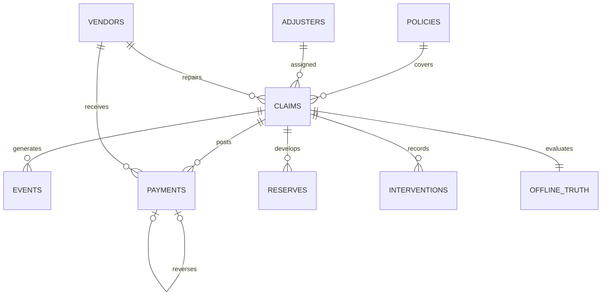

# Northstar Mutual personal auto methodology

## Business scope

First-notice staff capture evidence. Adjusters verify facts and make any authorized claim decisions. Team managers allocate discretionary review capacity and monitor delays. Finance reconciles paid loss, fees, avoidable exposure and realized recoveries. Specialist teams assess evidence where relevant. Governance teams audit discrimination risk, drift, calibration and overrides. A missing document or vendor residual is a prompt to check the file. Recommendations never authorize a delay, payment hold, coverage restriction or fraud referral.

Leakage is the synthetic avoidable portion of cost or a missed recovery opportunity. Severe accidents, legitimate supplements and complex repair work are common sources of appropriate spending. The generator treats legitimate loss and avoidable cost as separate quantities.

## Relational design

The [DuckDB DDL](../sql/schema.sql) defines physical types, primary keys, foreign keys and the nonnegative checks for payments and reserves. The pipeline adds cross-row checks for reversal ownership, dates, amounts, uniqueness and reconciliation. All stored money in the ledger is integer cents, and analysis and prediction dollars are divided by 100. Timestamps are on the synthetic civil date axis with no timezone shifts.

| Entity | Primary key | Fields and lifecycle |
| --- | --- | --- |
| Policies | `policy_id` | State, coverage, deductible, coverage limit, effective and expiration dates, standard synthetic conditions. There is one generated policy per claim, despite the schema supporting multiple claims on a policy. |
| Claims | `claim_id` | Policy link, incident, first notice, type, initial severity and estimate, early repair complexity, assigned vendor and adjuster, liability evidence, current reserve, status, first settlement and possible reopening. Final columns are retrospective. |
| Events | `event_id` | Claim, timestamp, type, numeric detail and source. Assignment detail is workload, assessment detail is complexity, and documentation indicates evidence available. |
| Payments | `payment_id` | Claim/vendor links, posting timestamp, positive nominal amount, category, status, invoice and original payment reference on reversals. Reversal rows subtract from paid loss. Duplicate indicators group initial payments on claim, invoice and amount. |
| Reserves | `claim_id, changed` | Timestamp, previous and new amounts, and reason. The closing reserve is zero in this mature ledger. |
| Vendors | `vendor_id` | Category, specialization, fixed prehistory turnaround days and supplement rate. These attributes are sampled from a prior period by construction. |
| Adjusters | `adjuster_id` | Team, experience and baseline workload. Per-claim assignment details live in timestamped events. |
| Interventions | `intervention_id` | Linked claim, review type/date, handling expense, observed result and recovery. This table logs routine background reviews without simulated treatment credit. The policy experiments produce a separate paired financial ledger. |
| Offline truth | `claim_id` | Label maturity date, actionable flag, mechanism, feasible flag, avoidable cents, latent effectiveness, legitimate and paid cents, missed recovery cents and completed duration. Stored separately as Parquet. |

## Synthetic generation and lifecycle

Seed 27 produces 120,000 first notices over four years from 2021 through 2024. A recurring 21-day surge increases intake and workload. Repair severity and complexity increase expected legitimate costs. Specialization routes complex work to different vendor pools. Workload, reporting delay and complexity affect document arrival and cycle time. Supplements occur on both legitimate and actionable claims. A minority of severity-one claims close within two days. A small share reopens, with a reclosure event five days later.

The generator caps legitimate cost below the selected limit and uses deductibles and lognormal severity noise. It generates the probability of avoidable costs as a noisy function of process burden, evidence availability and claim complexity. A separate draw controls feasibility. Six mechanism distributions overlap, and the latent response also varies within mechanism via a Beta(5, 3) draw. Missing recovery can occur without an extra payment. Ordinary adjustments with a later reversal sum to zero. These are process approximations from synthetic assumptions, with no real policy or claims data.

**Financial identity.** Net posted loss = legitimate cost + generated avoidable expense or opportunity − missed recovery opportunity. Actionable exposure is the feasible subset of avoidable expense or opportunity. Expected actionable exposure is probability × modeled conditional avoidable dollars. Gross simulated interception consists of prevented expenses and modeled recovered amounts. Net simulated savings deduct review expense and the modeled operational delay cost.

## Point-in-time design

A review at 72 hours gives staff time to collect the initial file and leaves time for an optional early desk review. Claims settled at or before the checkpoint are excluded. The SQL joins events and reserve changes only at or before the cutoff. Coverage, initial estimate, severity, liability and assigned repair characteristics are defined as immutable and known within the first 18 hours in this generator. Vendor history is fixed pre-period input, independent of labeled claims. State and team are kept for audit or display. Identifiers, state, team, final paid, closure duration, future claims events, and any ground truth are omitted from the predictor allowlist. A production schema would need immutable timestamps or versioned change history for all inputs.

Training uses outcomes mature by January 1, 2023. Calibration uses first notices from the next slice with outcomes mature by June 1, 2023. Validation uses the subsequent slice with outcomes mature before January 1, 2024. The holdout begins at the January 1, 2024 checkpoint, includes the first three days of 2025 for late-December notices, and freezes mature labels by June 1, 2025. Label maturity is first settlement plus 30 days, after modeled reopening and recovery deadlines. Recent claims near split boundaries can be excluded for immature outcomes, which can favor faster-maturing claims in the fitting slices.

## Model and uncertainty

Rules score missing documentation, long reporting delay, high workload and liability evidence. Logistic regression, a depth-limited random forest and two LightGBM settings compete by validation average precision. The simpler option wins within 0.002 AP. Each candidate has its own isotonic map fit on the earlier calibration slice. The validation threshold includes the largest set of tied scores that fits the 10% flag cap. Top-K as a separate operating scenario breaks score ties by claim order and covers 10% of the test cohort. This cutoff and the capacity scheduler serve different purposes.

Conditional amounts are fit only on actionable training cases, using severity means, forest and LightGBM candidates. Validation RMSE selects the estimator for the conditional mean. The reported 90% range uses a single validation residual radius, truncated at zero, so conditional coverage can differ by segment and severity. The month-block AP interval represents time-block resampling. Neither interval quantifies causal uncertainty or production transportability. Local reason codes change one feature to a training reference while leaving other fields fixed. Correlated inputs can make these reasons unstable.

## Review engine and paired experiments

Each same-day candidate action has a duration, cost rate, eligibility rule, response assumption and specialist flag in [decision.py](../src/decision.py). Budget, count, standard staff hours and specialist hours are hard daily resource limits. The specialist hour cap is a subset of total staff hours. A mixed integer program maximizes positive expected net benefits subject to at most one action per claim. The ranking baselines use the least expensive eligible action and fill capacity in rank order. Resource use and action routing can therefore differ across benchmarks.

The queue allows at most 0.75 modeled extra processing hours per claim and 0.35 for severity-five claims. Work exceeding same-day capacity expires. Review must run in parallel with ordinary service. The application does not schedule or execute a real review.

Planning factors are a 20% mechanism-match prior, a 25% response multiplier when mismatched, mean latent response of 5/8, and a 72% recoverable share conditional on success. The engine multiplies these assumptions by the candidate's base response, estimated actionable exposure and inflation, then deducts hours × action rate × cost multiplier and $12 per added delay hour. The simulator knows the sampled mechanism and response heterogeneity. Its realized response probability uses the actual match multiplier and latent draw. The same response uniform is reused for each claim template across strategies within a replay. These are designed treatment assumptions. Neither the routine review table nor the replay identifies a real treatment effect.

Each preset compares all six policies over the same populations for seeds 11, 27 and 53. The compact population contains all eligible Q1 2024 test scores. The replay resamples those templates. Volume changes draw count, prevalence shifts sampling weights via a separate evaluator, vendor inflation scales avoidable dollars, and documentation disruption changes action eligibility and the rules score. Frozen ML scores are retained in every scenario. This tests a frozen policy under distribution shifts and does not estimate the effect of retraining. Negative simulated net benefit is a valid result. Seeds cover Monte Carlo variability conditional on this generator and period.
